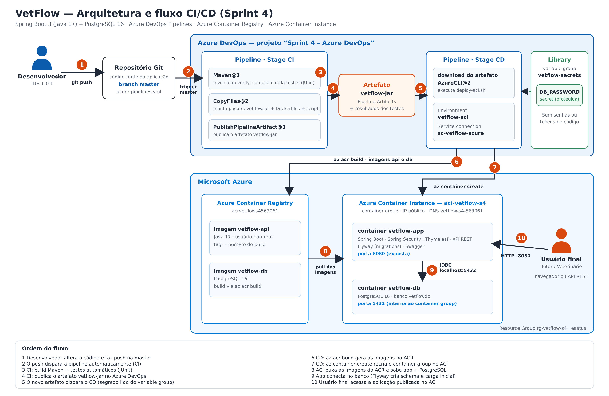

# VetFlow — Sprint 4 (CI/CD com Azure DevOps)

Challenge FIAP 2026 — DevOps Tools & Cloud Computing.

Professor: Marcus Martins Leite

## Integrantes do grupo

| Nome | RM | Turma |
|------|----|-------|
| Andrei de Paiva Gibbini | 563061 | 2TDSPF |
| Arthur Câmara | 562310 | 2TDSPG |
| Pedro Sakai Silva Zambaca | 565956 | 2TDSPF |
| Pedro Santos Pequini | 561842 | 2TDSPF |
| Diogo Cunha | 563654 | 2TDSPF |

## Descrição da solução

O VetFlow é uma plataforma de gestão da jornada de saúde de pets. Tutores e veterinários acessam a aplicação (interface web e API REST) para cadastrar tutores e pets, agendar consultas, registrar vacinas e acompanhar medicamentos. O acesso é controlado por login (perfis `TUTOR` e `VET`).

Nesta Sprint a aplicação é entregue por esteiras de CI/CD no Azure DevOps: cada alteração na branch `master` compila o código, executa os testes automáticos, publica o artefato e faz o deploy no Azure Container Instance (ACI).

## Stack

| Camada | Tecnologia |
|--------|-----------|
| Aplicação | Java 17, Spring Boot 3.4, Spring Web, Spring Data JPA, Spring Security, Thymeleaf |
| Banco de dados | PostgreSQL 16 em container (ACI), schema versionado com Flyway |
| Testes | JUnit 5, Mockito, Spring Boot Test / MockMvc (H2 em memória) |
| Build | Maven |
| Container | Docker, Azure Container Registry (ACR) |
| Deploy | Azure Container Instance (ACI) |
| CI/CD | Azure DevOps Pipelines (YAML) |

## Arquitetura e fluxo CI/CD



## Pipeline (`azure-pipelines.yml`)

Disparo automático a cada push na branch `master`.

**Stage CI — Build e Testes**
1. `Maven@3` executa `mvn clean verify`: compila e roda os testes automáticos (unitários e de integração). Os resultados são publicados na aba *Tests* da execução.
2. `CopyFiles@2` monta o pacote de deploy (`vetflow.jar`, Dockerfiles e script de deploy).
3. `PublishPipelineArtifact@1` publica o artefato `vetflow-jar` no Azure DevOps.

**Stage CD — Deploy no ACI** (executa após o CI gerar o artefato)
1. Baixa o artefato `vetflow-jar`.
2. `AzureCLI@2` executa `scripts/deploy-aci.sh`, que:
   - garante o Resource Group e o ACR;
   - constrói as imagens `vetflow-api` (tag = número do build) e `vetflow-db` no ACR;
   - recria o Container Group `aci-vetflow-s4` com os containers da API e do PostgreSQL;
   - aguarda a aplicação responder em `/login`; se não responder, a pipeline falha.

O banco usa armazenamento efêmero do container: cada deploy recria o banco e o Flyway recarrega o schema e os dados iniciais.

## Variáveis e segredos

| Variável | Onde | Observação |
|----------|------|-----------|
| `DB_PASSWORD` | Variable group `vetflow-secrets` (Library) | Protegida (secret). Não usar aspas simples na senha. |
| `resourceGroup`, `location`, `acrName`, `aciName`, `dnsLabel`, `dbName`, `dbUser` | `azure-pipelines.yml` | Não sensíveis |

A conexão com o Azure usa a service connection `sc-vetflow-azure`. Nenhuma senha ou token fica no código-fonte.

## Configuração do Azure DevOps (como reproduzir)

1. **Projeto:** `Sprint 4 – Azure DevOps`, visibilidade Private, controle de versão Git, processo Agile/Scrum. A descrição traz o nome do professor e os integrantes (RM e turma).
2. **Acesso do professor:** Organization settings → Users → o professor é adicionado com nível de acesso **Basic** e participa do projeto.
3. **Service connection:** Project settings → Service connections → Azure Resource Manager (service principal automático, escopo da assinatura), com o nome `sc-vetflow-azure`.
4. **Variable group:** Pipelines → Library → `vetflow-secrets`, com a variável `DB_PASSWORD` marcada como secreta (cadeado).
5. **Pipeline:** Pipelines → New pipeline → GitHub → este repositório → *Existing Azure Pipelines YAML file* → `/azure-pipelines.yml` na branch `master`. Na primeira execução, autorizar o uso do variable group, da service connection e do environment `vetflow-aci`.
6. **Disparo:** qualquer push na branch `master` inicia o CI; o CD roda quando o CI gera o artefato `vetflow-jar`.

## Executar os testes localmente

```
docker run --rm -v "%cd%:/app" -w /app maven:3.9-eclipse-temurin-17 mvn -B verify
```

## Acessar a aplicação

Após o deploy: `http://vetflow-s4-563061.eastus.azurecontainer.io:8080/login`

Usuário de teste (carga inicial do Flyway): `vet@vetflow.com` / `senha123`.

Login via API e CRUD:

```
curl -c cookies.txt -X POST http://<FQDN>:8080/api/auth/login -H "Content-Type: application/json" -d "{\"email\":\"vet@vetflow.com\",\"senha\":\"senha123\"}"
curl -b cookies.txt http://<FQDN>:8080/api/pets
```

Swagger: `http://<FQDN>:8080/swagger-ui.html`

## Banco de dados

Migrations Flyway em `src/main/resources/db/migration` (V1 schema, V2 usuários, V3 dados iniciais), compatíveis com H2 (testes) e PostgreSQL (nuvem).

### Evidência de persistência (SELECT no banco em nuvem)

O banco roda no container `vetflow-db` do ACI e não é exposto publicamente. Para consultar os dados, abra o `psql` dentro do container (PowerShell ou Cloud Shell):

```
az container exec --resource-group rg-vetflow-s4 --name aci-vetflow-s4 --container-name vetflow-db --exec-command "psql -U vetflow -d vetflowdb"
```

Consultas usadas para provar cada operação do CRUD:

```sql
SELECT id, name, email, phone FROM cv_tutors;                 -- após criar / atualizar / excluir
SELECT id, name, species, breed, tutor_id FROM cv_pets;
SELECT p.id, p.name AS pet, t.name AS tutor
  FROM cv_pets p JOIN cv_tutors t ON t.id = p.tutor_id;       -- relação entre as tabelas
```

Saia do `psql` com `\q`.

## Estrutura

```
azure-pipelines.yml     pipeline CI/CD
docs/                   diagrama de arquitetura e CI/CD, DER, diagrama de classes, collection Postman
Dockerfile              imagem da API (usa o jar do artefato, usuário não-root)
Dockerfile.postgres     imagem do PostgreSQL
scripts/deploy-aci.sh   build das imagens e deploy no ACI
src/main                aplicação
src/test                testes automáticos
```
